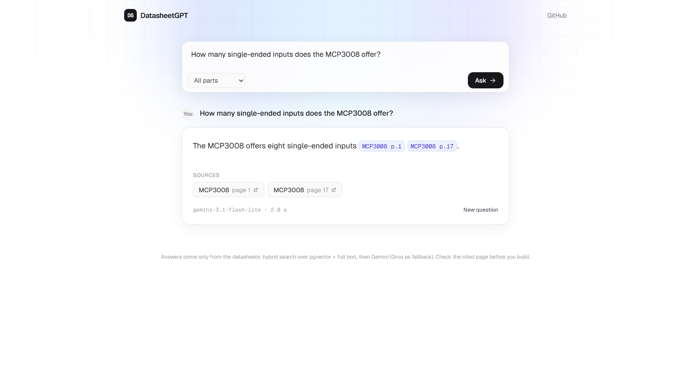
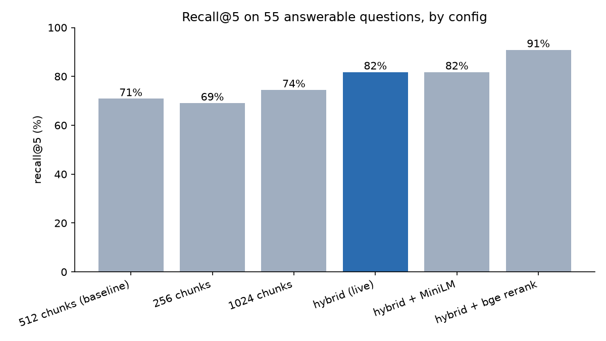
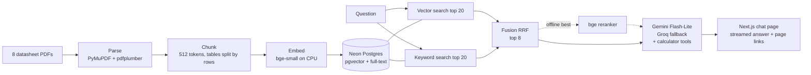

# DatasheetGPT

Ask a question about an electronic component datasheet and get a short answer that cites the exact PDF page it came from. A retrieval-augmented generation (RAG) system over 8 real datasheets, measured on a 60-question evaluation set I built and froze before any experiment.

**Live demo:** https://datasheetgpt.vercel.app
**API:** https://datasheetgpt-api.onrender.com (`/docs` for the Swagger page, `/health` for a status check)

> **Cold start:** the API runs on Render's free tier and sleeps after 15 minutes idle. The first question after that can take about a minute while it wakes up. The page shows a "waking up" notice and retries by itself; later questions answer in a few seconds.



## Results

Every configuration was scored on the same 60 questions (`eval/questions.jsonl`, tag `eval-v1`). Every run is logged in `results/runs.csv`; this table and the chart are made from it by `scripts/plot_results.py`.

| Config | Recall@5 | MRR | Answer accuracy | Citation accuracy | Median latency |
|---|---|---|---|---|---|
| 512-token chunks, vector search (baseline) | 71% | 0.517 | 77% | 73% | 3.9 s |
| 256-token chunks | 69% | 0.451 | - | - | - |
| 1024-token chunks | 74% | 0.506 | 73% | 67% | 4.4 s |
| **Hybrid search (live)** | **82%** | 0.515 | 80% | 76% | 5.9 s |
| Hybrid + MiniLM reranker | 82% | 0.598 | - | - | - |
| Hybrid + bge reranker (best offline) | 91% | 0.750 | 88% | 84% | 20.1 s |



**What helped most:** adding keyword search to vector search (hybrid) gave the biggest cheap gain, recall@5 71% to 82%, because questions name exact part numbers and parameter names that embeddings blur. A cross-encoder reranker on top lifted recall@5 to 91% and doubled recall@1 (31% to 62%), but it needs about 1 GB of RAM and 10 to 17 s per question on CPU, so the live app runs hybrid search and the reranker is reported as the best offline result.

Notes on the numbers:
- "-" means retrieval only; the answer judge was not run for that config.
- All 5 unanswerable questions get "Not found in the datasheets" instead of a made-up value.
- Latency is the full answer time on my laptop and includes Gemini free-tier 503 errors with Groq fallback. Retrieval alone on the live setup averages 1.2 s.
- The remaining failures (very long ATmega328P sheet, two-part comparison questions, merged MIN/TYP/MAX table cells) are analysed in `notes.md`.

## How it works



1. **Parse** (`ingest/parse.py`): PyMuPDF reads the text of each page; pdfplumber turns tables into Markdown with their caption; repeated headers and footers are removed. 2,578 blocks, 707 tables.
2. **Chunk** (`ingest/chunk.py`): 512-token chunks with 64 overlap. Long tables are split between rows with the caption and header row repeated, so no value loses its column name. Every chunk starts with its part, page and section. 3,094 chunks.
3. **Embed** (`ingest/embed.py`): `BAAI/bge-small-en-v1.5` on CPU through fastembed, stored in Postgres with pgvector (HNSW index) and a generated full-text column (GIN index).
4. **Retrieve** (`ingest/retrieve.py`): vector top 20 and keyword top 20 merged with reciprocal rank fusion (k=60); the top 8 chunks go on. An optional reranker mode (`ingest/rerank.py`) re-orders the fused top 20.
5. **Answer** (`api/answer.py`): Gemini `gemini-3.1-flash-lite` gets the chunks as numbered blocks and must answer only from them, cite like `[LM358 p.4]`, or say "Not found in the datasheets". It can call two calculator tools (`api/tools.py`: voltage divider, unit conversion) for arithmetic. Groq `openai/gpt-oss-20b` is the fallback. Answers are cached in Postgres.
6. **Serve**: FastAPI (`api/main.py`, `app.py`) streams the answer as server-sent events on `POST /ask/stream`; the Next.js page in `web/` shows tokens as they arrive and turns each citation into a link to that PDF page.

## Evaluation

- **Question set** (`eval/questions.jsonl`): 60 questions with an expected answer and gold page(s): 25 lookups, 15 table values, 10 numeric/unit, 5 comparing two parts, 5 unanswerable. AI-drafted from the PDFs, every gold page checked by hand, frozen before the first experiment (git tag `eval-v1`).
- **Retrieval** (`eval/retrieval.py`): recall@5 and MRR against the gold pages.
- **Answers** (`eval/judge.py`): an LLM judge (Groq `openai/gpt-oss-120b`, a different model from the one answering) grades each answer correct, partly correct or wrong. Citations are checked in code against the gold pages. My hand check of 15 judge verdicts agreed 15 of 15.
- **Logging** (`eval/record_run.py`): one row per config in `results/runs.csv`.

## Datasheets

1,099 pages in total, all text-based PDFs. Revisions are in `data/sources.csv`. The PDFs are not in the repo (manufacturer copyright); `scripts/download_pdfs.py` fetches them.

| Part | Manufacturer | Pages | Datasheet |
|---|---|---|---|
| ESP32 | Espressif | 78 | [PDF](https://www.espressif.com/sites/default/files/documentation/esp32_datasheet_en.pdf) |
| ATmega328P | Microchip | 653 | [PDF](https://ww1.microchip.com/downloads/aemDocuments/documents/MCU08/ProductDocuments/DataSheets/ATmega48A-PA-88A-PA-168A-PA-328-P-DS-DS40002061B.pdf) |
| STM32F103 | STMicroelectronics | 114 | [PDF](https://www.st.com/resource/en/datasheet/stm32f103c8.pdf) |
| LM358 | Texas Instruments | 68 | [PDF](https://www.ti.com/lit/ds/symlink/lm358.pdf) |
| NE555 | Texas Instruments | 39 | [PDF](https://www.ti.com/lit/ds/symlink/ne555.pdf) |
| LM317 | Texas Instruments | 45 | [PDF](https://www.ti.com/lit/ds/symlink/lm317.pdf) |
| MCP3008 | Microchip | 42 | [PDF](https://ww1.microchip.com/downloads/aemDocuments/documents/MCU08/ProductDocuments/DataSheets/MCP3004-MCP3008-Data-Sheet-DS20001295.pdf) |
| BME280 | Bosch Sensortec | 60 | [PDF](https://www.bosch-sensortec.com/media/boschsensortec/downloads/datasheets/bst-bme280-ds002.pdf) |

## Stack, and why it costs nothing

| Piece | Used for | Why it's free |
|---|---|---|
| Python 3.11, FastAPI | API and eval scripts | Open source |
| PyMuPDF, pdfplumber | PDF text and tables | Open source, run locally |
| fastembed + `bge-small-en-v1.5` | Embeddings | Open model, runs on CPU, no embedding API to pay for |
| `bge-reranker-base`, MiniLM | Reranking experiments | Open models on CPU |
| PostgreSQL + pgvector on Neon | Vector and full-text search, answer cache | Neon free plan (0.5 GB is plenty for 3,094 chunks) |
| Gemini API | Answers | Google AI Studio free tier |
| Groq | Fallback answers and the judge | Groq free tier |
| Render | Hosts the API | Free web service (sleeps when idle, hence the cold start) |
| Next.js 16, React 19, Tailwind 4 on Vercel | Chat page | Vercel Hobby plan |
| matplotlib, pytest | Chart and tool tests | Open source |

## Run it locally

You need Python 3.11, [uv](https://docs.astral.sh/uv/) (or plain `pip`), Node 22+ with pnpm for the web page, and three free accounts: [Neon](https://neon.tech), [Google AI Studio](https://aistudio.google.com/apikey) and [Groq](https://console.groq.com/keys).

**1. Install**

```
git clone https://github.com/project-devo/datasheetgpt.git
cd datasheetgpt
uv venv --python 3.11
.venv\Scripts\activate          # Windows; on macOS/Linux: source .venv/bin/activate
uv pip install -r requirements-ingest.txt
```

`requirements.txt` holds only what the server needs (that is what Render installs); `requirements-ingest.txt` adds the PDF, chart and test packages.

**2. Keys**

Create a Neon project, then copy `.env.example` to `.env` and fill in `DATABASE_URL` (Neon connection string), `GEMINI_API_KEY` and `GROQ_API_KEY`. The tables and the `vector` extension are created by the ingest step.

**3. Get the datasheets and ingest them**

```
python scripts/download_pdfs.py     # 8 PDFs into data/
python scripts/check_pdfs.py        # page counts, should total 1,099
python ingest/parse.py              # about 2-3 min -> data/parsed/
python ingest/chunk.py              # -> data/chunks/s512-o64.jsonl, 3,094 chunks
python ingest/embed.py              # about 10 min on CPU -> Neon
```

If a manufacturer site refuses the download, open the link from the table above in a browser and save it as `data/<part>.pdf` (for example `data/lm358.pdf`). The chunk-size experiments use `python ingest/chunk.py --size 256` (or `1024`) and then `python ingest/embed.py --config s256-o64`.

**4. Run the API**

```
python app.py
```

Open http://localhost:7860/docs and try `POST /ask` with `{"question": "What is the maximum supply voltage of the LM358?"}`. The first call downloads the embedding model (about 130 MB).

**5. Run the chat page (optional)**

```
cd web
pnpm install
copy .env.example .env.local        # macOS/Linux: cp .env.example .env.local
pnpm dev
```

Open http://localhost:3000. It talks to the API on port 7860.

**6. Reproduce the results**

```
python eval/retrieval.py                     # baseline: recall@5 71%, MRR 0.517
python eval/retrieval.py --mode hybrid       # live config: recall@5 82%
python eval/retrieval.py --mode rerank       # bge reranker: recall@5 91% (downloads ~1 GB model)
python eval/judge.py --mode hybrid --no-cache
python eval/record_run.py --config s512-o64-hybrid
python scripts/plot_results.py               # rewrites results/results.md and the chart
python -m pytest tests                       # calculator tool tests
```

Retrieval numbers are deterministic and should match the table. Answer accuracy moves by a few points between runs, because the free Gemini tier sometimes returns 503 and the answer then comes from Groq. The judge uses the free Groq tier, so a full 60-question run takes a while; `--limit 10` runs a few first.

## Deploying

- **API on Render:** web service from this repo, build `pip install -r requirements.txt`, start `python app.py`, health check `/health`. Environment: `DATABASE_URL`, `GEMINI_API_KEY`, `GROQ_API_KEY`, `PYTHON_VERSION=3.11.11`, `WEB_ORIGIN=<your Vercel URL>` (for CORS). No quotes around values.
- **Web on Vercel:** root directory `web`, environment `NEXT_PUBLIC_API_URL=<your Render URL>`.

## Repo layout

```
api/        FastAPI app, answer generation, calculator tools
ingest/     parse, chunk, embed, retrieve, rerank, database helpers
eval/       question set, retrieval metrics, LLM judge, run logger
results/    per-question results, runs.csv, results.md, recall_at_5.png
scripts/    download and check PDFs, plot results, debugging helpers
tests/      pytest tests for the calculator tools
web/        Next.js chat page
notes.md    experiment notes and failure analysis
app.py      server entry point (API + a small Gradio page at /)
```

## Limitations

- 8 datasheets and 60 questions: enough to compare configurations, too small for fine-grained claims.
- Free tiers: Gemini returns 503 at busy times (Groq answers instead, a bit less accurately), and Render sleeps when idle.
- The best reranker does not fit the 512 MB free Render instance, so the live app is not the most accurate configuration.
- Answers come only from the datasheets, but always check the cited page before you build a circuit.
